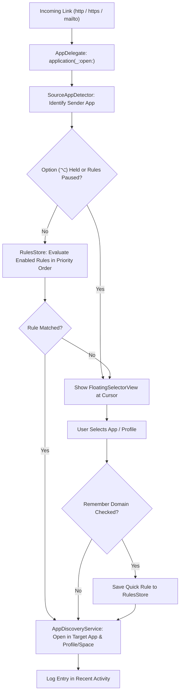

# maxguspicker1824

> **A native macOS Link & Mail Router with Multi-Browser Profile Support, Source-App Detection, and a Visual Rule Engine.**

-blue)


**maxguspicker1824** is a lightweight, menu-bar macOS utility inspired by Bumpr, Choosy, and Velja. When set as your default web browser and default email reader, it intercepts every `http`, `https`, and `mailto` link you click across macOS:

- **Matches a Rule?** Automatically forwards the link to your configured browser (and specific browser profile/space) or mail client in the background.
- **No Rule Match?** Spawns a sleek, cursor-positioned floating picker right under your mouse so you can pick the app or profile on the fly—or create a routing rule with a single click.

---

## ✨ Features

### 1. Cursor-Positioned Floating App & Profile Selector
- **Appears Right at Your Cursor**: Spawns a borderless, non-activating `NSPanel` with `.ultraThinMaterial` blur centered at your mouse pointer (clamped to screen bounds).
- **Instant Profile Selection**: Left-click an app icon to open in its default window, or click the profile chevron (`▾`) / right-click the icon to pick a specific browser profile or workspace directly from the popup.
- **One-Click Quick Rules**: Check **"Always open `<domain/recipient>` with chosen app"** before clicking an icon to save a permanent routing rule on the spot.
- **Effortless Dismissal**: Click anywhere outside the popup or press `Esc` to dismiss.
- **Modifier Key Override (`Option ⌥`)**: Hold **Option (`⌥`)** while clicking any link to bypass all automatic routing rules and force the floating selector to appear.

### 2. Deep Browser Profile & Workspace Discovery
Automatically detects and launches links into specific profiles or spaces without spawning duplicate Dock instances:

| Browser | Profile Discovery Source | Launch Mechanism |
| :--- | :--- | :--- |
| **Google Chrome** | `~/Library/Application Support/Google/Chrome/Local State` | Direct binary invocation with `--profile-directory="<Dir>"` |
| **Brave Browser** | `~/Library/Application Support/BraveSoftware/Brave-Browser/Local State` | Direct binary invocation with `--profile-directory="<Dir>"` |
| **Microsoft Edge / Vivaldi** | Chromium `Local State` (`profile.info_cache`) | Direct binary invocation with `--profile-directory="<Dir>"` |
| **Firefox** | `~/Library/Application Support/Firefox/profiles.ini` | Direct binary invocation with `-P "<ProfileName>"` |
| **Arc** | Live AppleScript query of front window Spaces | AppleScript targeting `space "<SpaceName>"` |
| **Safari (macOS 14+)** | `System Events` inspection of `File → New Window` profile items | Reuses open `<Profile> —` window or triggers `New <Profile> Window` |
| **Mail Clients** | LaunchServices `mailto:` handler discovery | Standard `NSWorkspace` activation & URL handoff |

### 3. Context-Aware Source Application Routing
- Detects **which application originated the click** (e.g., Slack, Notion, Linear, Terminal, Apple Mail) via the incoming `kAEGetURL` AppleEvent sender PID (`keyAddressAttr`) with fallback to `NSWorkspace.shared.frontmostApplication`.
- Build rules that route **all links clicked inside a specific app** (e.g., *"Clicked in Slack • any website link → Google Chrome (Work)"*) or combine source app + URL conditions.

### 4. Human-Friendly Visual Rule Engine (No Regex Required)
- **Sentence-Style Rules**: Build rules using plain-English fields and operators instead of raw regular expressions:
  - **Web Fields**: `Website Domain`, `Full Web Address`, `URL Path`
  - **Email Fields**: `Recipient Email`, `Email Domain (@company.com)`, `Email Subject`
  - **Operators**: `contains`, `is exactly` (automatically normalizes leading `www.`), `starts with`, `ends with`, and `matches regex (advanced)`
- **Drag-and-Drop Priority**: Reorder rules in the Graphical Rules Manager to control evaluation priority immediately.
- **Live Rule Tester Sandbox**: Paste any URL or email address into the bottom tester bar (`wand.and.stars`) to see in real time which rule card lights up in green—or if the floating app selector will be shown.

### 5. Menu Bar Control Center & 3-Step Onboarding Wizard
- **Menu Bar Status Item (`MenuBarExtra`)**:
  - Live warning banner if **maxguspicker1824** is not currently set as the default browser.
  - **Pause Rules** toggle (`pause.circle`) to temporarily force the floating picker for all links.
  - **Recent Activity** submenu showing the last 5 routed links, their source app, and target destination.
  - Quick access to **Routing Rules (`⌘,`)** and the **Setup & Permissions Wizard**.
- **Interactive Onboarding Wizard**:
  - Automatically opens on first launch with live-polling green checkmarks for configuring **Default Web Browser**, **Default Email Reader**, and **Accessibility Permission** (for Safari/Arc automation).

---

## 🧭 Architecture & Routing Flow



---

## 📂 Project Structure

```text
maxguspicker1824/
├── Package.swift                                      # SwiftPM manifest (macOS 14+)
├── Makefile                                           # Build, bundle, run, test, and clean targets
├── TODO.md                                            # Phased implementation tracker
├── Resources/
│   ├── Info.plist                                     # LSUIElement + http/https/mailto URL schemes
│   └── maxguspicker1824.entitlements                  # Sandbox disabled + AppleEvents entitlement
├── scripts/
│   └── bundle_app.sh                                  # Compiles, assembles, signs & registers .app bundle
├── Sources/maxguspicker1824/
│   ├── App/
│   │   ├── maxguspicker1824App.swift                  # @main entry point, MenuBarExtra & Window scenes
│   │   └── AppDelegate.swift                          # URL interception, FloatingPanel & quick rules
│   ├── Models/
│   │   ├── AppTarget.swift                            # BrowserEngine, BrowserProfile, AppTarget, SourceAppInfo
│   │   └── RoutingRule.swift                          # RouteType, MatchField, MatchOperator, RoutingRule
│   ├── Services/
│   │   ├── AppDiscoveryService.swift                  # Handler discovery & browser/profile launching
│   │   ├── ProfileDiscoveryService.swift              # Chrome, Brave, Edge, Vivaldi, Firefox, Arc & Safari profiles
│   │   ├── RulesStore.swift                           # Rule evaluation engine, persistence & activity log
│   │   ├── SourceAppDetector.swift                    # AppleEvent PID & frontmost app detection
│   │   └── SystemIntegrationService.swift             # Default browser/mail & Accessibility status manager
│   └── Views/
│       ├── FloatingSelectorView.swift                 # Cursor-positioned floating picker UI
│       ├── OnboardingWizardView.swift                 # 3-step setup & permissions wizard
│       ├── RuleBuilderSheet.swift                     # 3-step visual rule creation/editing sheet
│       └── RulesManagerView.swift                     # Graphical rules list, cards & live rule tester bar
└── Tests/maxguspicker1824Tests/
    └── RulesStoreTests.swift                          # Unit test suite for routing rules & persistence
```

---

## 🛠️ How to Build, Run, and Test

### Prerequisites
- **macOS 14.0 (Sonoma)** or later
- **Apple Command Line Tools** or **Xcode** (`swift` 5.9+ / 6.x)

### 1. Build & Package `maxguspicker1824.app`
The project includes an automated packaging script that compiles the release binary via Swift Package Manager, assembles the `build/maxguspicker1824.app` bundle with `Info.plist`, signs it with `maxguspicker1824.entitlements`, and registers it with macOS LaunchServices:

```bash
make app
```
*(Or run `./scripts/bundle_app.sh release` directly.)*

### 2. Launch the Application
```bash
make run
```
*(Or run `open build/maxguspicker1824.app`.)*

When launched:
1. Look for the branch icon (`arrow.triangle.branch`) in your **macOS Menu Bar**.
2. On first launch, the **Welcome to maxguspicker1824** onboarding wizard will appear to help you set it as your default browser, default mail client, and grant optional Accessibility access.

### 3. Test Link & Mail Routing from the Terminal
You can simulate clicking web links or `mailto:` links at any time using `open -a`:

```bash
# Test a web link
open -a build/maxguspicker1824.app "https://github.com/apple/swift"

# Test an email link with subject
open -a build/maxguspicker1824.app "mailto:billing@acme.com?subject=Monthly%20Invoice"
```

### 4. Run the Automated Unit Tests
```bash
make test
```

### 5. Clean Build Artifacts
```bash
make clean
```

---

## ⌨️ Shortcuts & Tips

| Shortcut / Action | Behavior |
| :--- | :--- |
| **`Option (⌥)` + Click Link** | Bypass all routing rules and force the floating app selector at the cursor |
| **`Esc` or Click Outside** | Dismiss the floating app selector without opening any application |
| **Click `▾` or Right-Click Icon** | Choose a specific browser Profile or Arc Space in the floating selector |
| **`⌘ ,` (in Menu Bar)** | Open the **Routing Rules** graphical editor |
| **`⌘ Q` (in Menu Bar)** | Quit **maxguspicker1824** |

---

## 📄 License

This project is licensed under the **MIT License** — see the [LICENSE](LICENSE) file for details.
