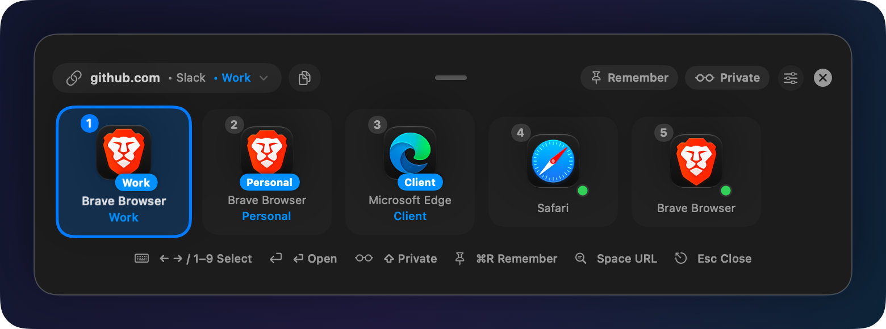
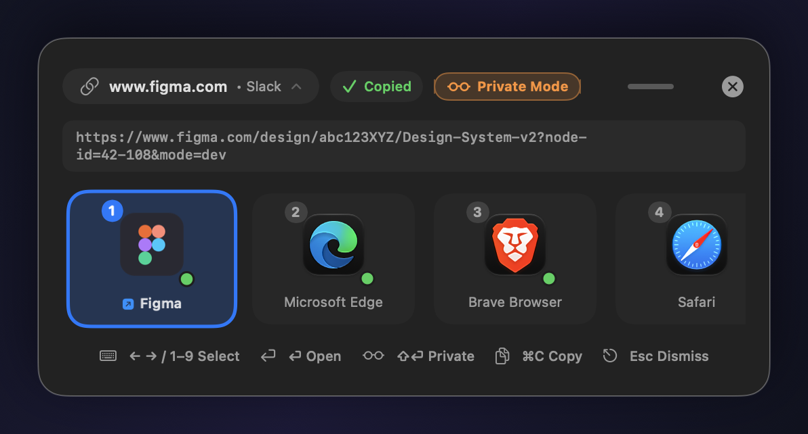
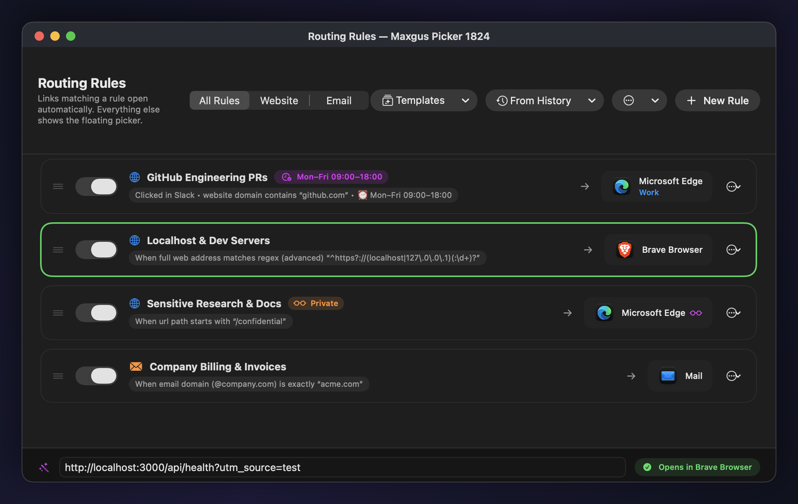
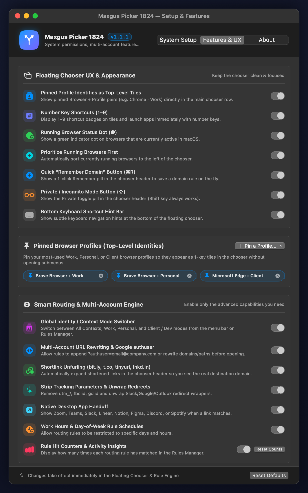
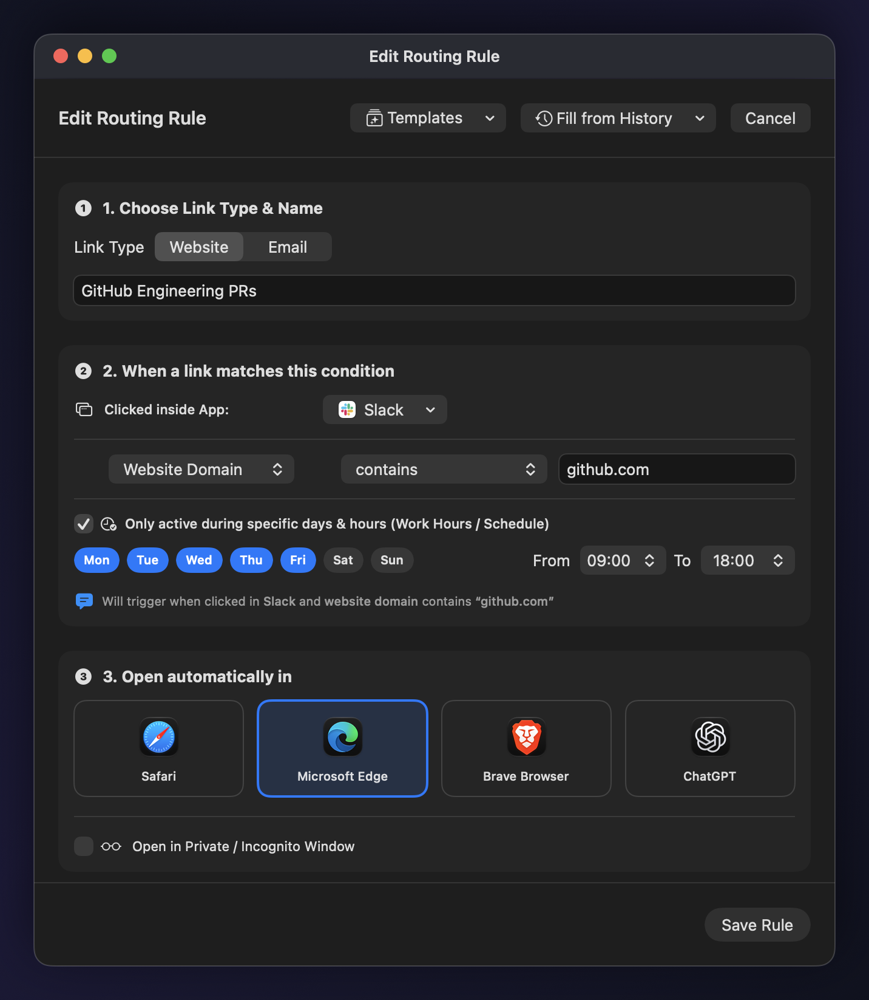
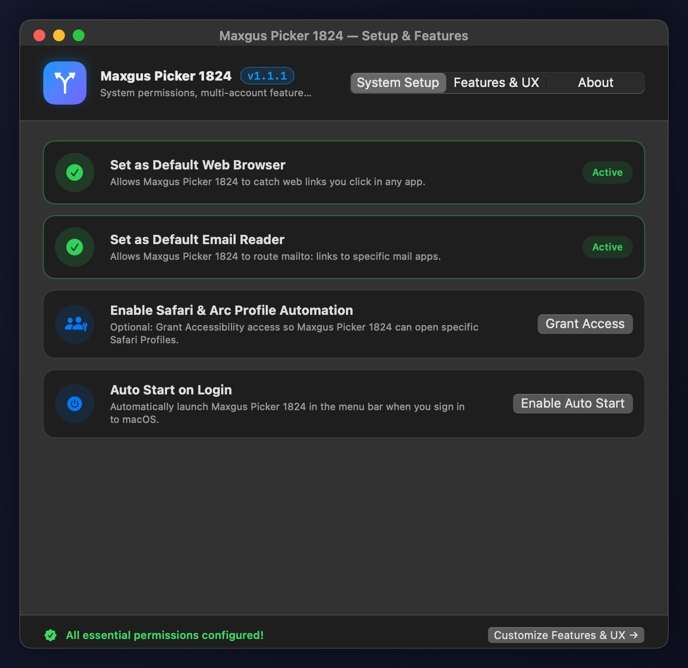
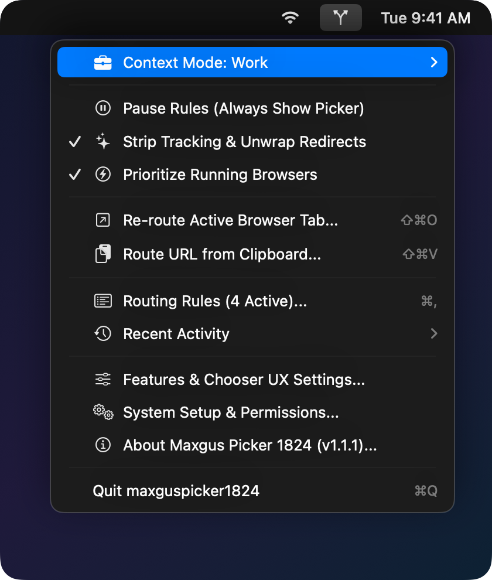
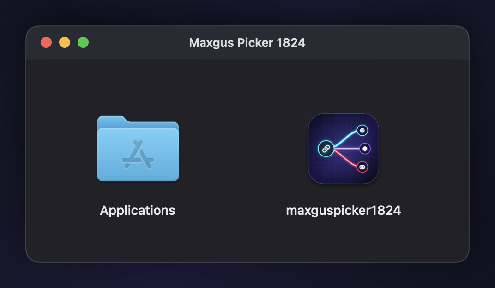
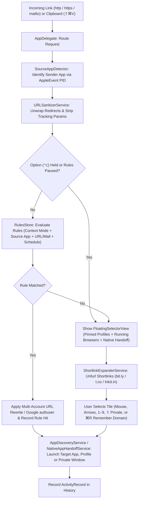

<p align="center">
  
</p>

<h1 align="center">Maxgus Picker 1824 (<code>maxguspicker1824</code>)</h1>

<p align="center">
  <strong>A native macOS Link &amp; Mail Router built for Multi-Account &amp; Multi-Identity Workflows — featuring Pinned Browser Profiles, Global Context Modes, Multi-Account URL Rewriting (<code>authuser</code>), Shortlink Unfurling, Source-App Detection, Native App Handoff, Work-Hours Scheduling, and a Customizable Chooser UX.</strong>
</p>

<p align="center">
  
  
  
  
  
</p>

**Maxgus Picker 1824** (`maxguspicker1824`) is a fast, native, menu-bar macOS utility built for users with **multi-account setups** who maintain separate contexts, workspaces, or identities across different browsers, browser profiles, or email clients. When registered as your default web browser and default email reader, it intercepts every `http`, `https`, and `mailto` link you click across macOS, sanitizes tracking parameters, unwraps nested redirects, expands shortlinks, and routes the link to the right identity or browser in milliseconds:

- **Matches an Active Rule?** Automatically routes the link in the background to your configured browser, specific **Browser Profile / Space**, **Private / Incognito window**, or **Mail Client**—with optional **Google `authuser` injection** or **URL domain/path rewriting**.
- **No Rule Match (or `Option ⌥` Held)?** Spawns a desktop-scaled, draggable, keyboard-navigable **Floating App & Identity Selector** right on your active Space (including over Full-Screen apps) so you can choose a **Pinned Browser Profile** or application with your mouse, arrow keys, or `1`–`9` number hotkeys—or press **`⌘R`** (*Remember*) to save a domain rule on the fly.
- **Customizable & Decluttered by Design**: Includes a dedicated **Features & Chooser UX Settings** panel where every advanced feature and Chooser UI element can be individually enabled or disabled so the interface stays clean and tailored to your workflow.

---

## 📸 Visual Tour & Screenshots

### 1. Floating App & Identity Selector (Standard & Power-User Modes)

| Pinned Profile Identities & Clean Chooser UX | Shortlink Unfurling, Remember (`⌘R`), Private (`⇧`) & Native Handoff |
| :---: | :---: |
|  |  |
| *Pinned **Browser + Profile** identity tiles (`Brave Browser • Work`, `Personal`, `Microsoft Edge • Client`), numbered `1–9` badges, source-app (`• Slack`) & active context (`• Work`) indicators, and header action pills.* | *Shortlink (`bit.ly`) unfurled to `www.figma.com`, **Remember (`⌘R`)** and **Private (`⇧`)** toggled on, `✓ Copied` confirmation, and **Figma** surfaced as a Native Desktop App Handoff tile.* |

---

### 2. Graphical Routing Rules Manager, Context Switcher & Live Rule Tester

<p align="center">
  
</p>

- **Global Context Mode Switcher**: Switch between **All Contexts**, **Work**, **Personal**, and **Client / Dev** directly from the Rules Manager header or Menu Bar.
- **Priority-Ordered Rule Cards**: Drag and drop rules to reorder evaluation priority, toggle rules on/off individually, and view at-a-glance badges for **Context Mode** (`Work`, `Client / Dev`), **Work Hours Schedules** (`Mon–Fri 09:00–18:00`), **Multi-Account Google `authuser`** (`authuser=alejandro@company.com`), **Private Windows** (`Private`), **Rule Hit Counters** (`42 hits`, `28 hits`), and **Target Browser Profiles** (`Work`, `Client`).
- **Real-Time Rule Tester Bar**: Paste any URL or email address at the bottom of the window to immediately highlight which rule matches (in green) and preview the exact destination app and profile.

---

### 3. Features & Chooser UX Control Center + Visual 3-Step Rule Builder

| Features & Chooser UX Settings Control Center | Visual 3-Step Rule Builder (with Multi-Account Rewrite) |
| :---: | :---: |
|  |  |
| *Toggle any Chooser UI element or Smart Routing engine feature on/off to keep the interface minimal or power-packed, and pin/unpin **Browser + Profile** identities as top-level Chooser tiles.* | *Build rules with **Source App** & **Context Mode** filters, **Work Hours Schedules**, **Target Profiles**, and **Multi-Account URL Transformation** (`?authuser=` injection & substring replacement).* |

---

### 4. System Setup Wizard, Menu Bar Control Center & `.dmg` Installer

| System Setup & Permissions Wizard | Menu Bar Control Center | Universal macOS `.dmg` Installer |
| :---: | :---: | :---: |
|  |  |  |
| *4-step guided permissions setup for Default Browser, Default Mail Reader, Safari/Arc Automation, and Auto Start on Login.* | *Switch **Context Mode**, toggle rules/sanitizer, **Re-route Active Tab (`⇧⌘O`)**, **Route URL from Clipboard (`⇧⌘V`)**, or open **Features & Chooser UX Settings**.* | *Self-contained `.dmg` installer with custom **Neon Prism Router** app icon and `/Applications` shortcut.* |

---

## ✨ Complete Feature Guide & Detailed Functionality

### 🎛️ 1. Customizable Features & Chooser UX Control Center
Multi-account power features should never make the Floating Chooser feel cluttered or overwhelming. [`FeatureSettings`](Sources/maxguspicker1824/Models/AppTarget.swift) provides granular toggles (accessible via **Menu Bar → Features & Chooser UX Settings...**, the **Routing Rules** toolbar, or the **`slider.horizontal.3`** icon on the Floating Chooser):
- **Floating Chooser UX & Appearance Toggles**:
  - **Pinned Profile Identities as Top-Level Tiles**: Show pinned `Browser + Profile` pairs (e.g. *Brave • Work*, *Chrome • Personal*, *Edge • Client*) directly in the main chooser row.
  - **Number Key Shortcuts (`1–9`)**: Display `1–9` shortcut badges on tiles and launch apps/profiles immediately with number keys.
  - **Running Browser Status Dot (`●`)**: Show a green indicator dot on browsers that are currently active in macOS.
  - **Prioritize Running Browsers First**: Automatically sort currently running browsers to the left of the chooser.
  - **Quick “Remember Domain” Button (`⌘R`)**: Show a 1-click `Remember` pill in the chooser header to save a domain rule on the fly.
  - **Private / Incognito Mode Button (`⇧`)**: Show the `Private` toggle pill in the chooser header (`Shift` key always works even when the pill is hidden).
  - **Bottom Keyboard Shortcut Hint Bar**: Show or hide the keyboard navigation legend at the bottom of the chooser.
- **Smart Routing & Multi-Account Engine Toggles**:
  - Individually enable or disable **Global Identity / Context Mode Filtering**, **Multi-Account URL Rewriting & Google `authuser`**, **Shortlink Unfurling**, **URL Tracking Stripper & Redirect Unwrapper**, **Native Desktop App Handoff**, **Work Hours Schedules**, and **Rule Hit Counters**.

---

### 👤 2. Pinned Browser Profiles as Top-Level Chooser Identities
Instead of opening a submenu every time you want to pick between your *Work*, *Personal*, or *Client* browser profile, [`PinnedProfileIdentity`](Sources/maxguspicker1824/Models/AppTarget.swift) promotes your favorite `Browser + Profile` combinations to **first-class tiles** in the Floating Chooser:
- Pin or unpin any discovered profile from the **Pinned Browser Profiles** section in *Features & Chooser UX Settings*, or right-click any browser tile inside the Floating Chooser.
- Each pinned profile gets its own dedicated tile, profile badge (`Work`, `Personal`, `Client`), and `1`–`9` single-key shortcut.

---

### 🎭 3. Global Identity / Context Mode Switcher (`Work` / `Personal` / `Client / Dev`)
Switch your active workspace identity with one click from the **Menu Bar** or the **Routing Rules** header ([`IdentityContext`](Sources/maxguspicker1824/Models/AppTarget.swift)):
- Modes: **All Contexts**, **Work**, **Personal**, and **Client / Dev**.
- Any routing rule can be scoped to a specific Context Mode (e.g. route `github.com` and `meet.google.com` to your *Work* profile while in **Work** mode, or to your *Personal* browser when switched to **Personal** mode).
- The active context mode is also displayed in the Floating Chooser header pill (`• Work`).

---

### ⚡ 4. Instant Rule Creation from the Chooser (`⌘R` — “Remember Domain”)
When an unfamiliar link opens the Floating Chooser, you don't need to open the Rules Editor to create a rule:
- Click the **`Remember`** pill in the chooser header (or press **`⌘R`**) so it highlights in blue, then click or press `1`–`9` / `Enter` on your desired browser, pinned profile, or private window.
- [`RulesStore.saveQuickDomainRule`](Sources/maxguspicker1824/Services/RulesStore.swift) automatically creates (or updates) a domain rule for that website pointing to your chosen browser, profile, private mode, and active Context Mode.

---

### 🔄 5. Multi-Account URL Rewriting & Google `authuser` Injection
Web apps like Google Meet, Google Docs, Google Drive, Calendar, and Google Cloud Console often default to `/u/0/` even when opened in a specific browser. [`RoutingRule.transformURL(_:)`](Sources/maxguspicker1824/Models/RoutingRule.swift) lets any rule transform the URL before opening:
- **Google Account (`authuser`) Injection**: Specify an email (`alejandro@company.com`) or account index (`0`, `1`, `2`) on a rule to automatically append `?authuser=...` to matching URLs.
- **Substring Find & Replace**: Rewrite internal hostnames, environments, or frontends on the fly (e.g. replace `legacy-wiki.internal` with `wiki.company.com`).

---

### 🔍 6. Shortlink Unfurling (`bit.ly`, `t.co`, `tinyurl.com`, `lnkd.in`) & Clipboard Router (`⇧⌘V`)
- **Asynchronous Shortlink Expander ([`ShortlinkExpanderService`](Sources/maxguspicker1824/Services/ShortlinkExpanderService.swift))**:
  - When a shortened URL (`bit.ly`, `t.co`, `tinyurl.com`, `lnkd.in`, `buff.ly`, `ow.ly`, `is.gd`, `rb.gy`, `short.io`, `rebrand.ly`, `cutt.ly`, `trib.al`, `bl.ink`) opens in the Floating Chooser, Maxgus Picker 1824 resolves the HTTP redirect chain in the background and updates the chooser header (`bit.ly → www.figma.com`) and URL inspector with the real destination URL.
- **Route URL from Clipboard (`⇧⌘V`)**:
  - Copied a URL, domain (`github.com/apple/swift`), or email address (`billing@company.com`) from a terminal or document where it wasn't clickable? Trigger **Menu Bar → Route URL from Clipboard... (`⇧⌘V`)** to sanitize it and open the Floating Chooser immediately.

---

### 🎯 7. Floating App Selector & Power-User Keyboard Workflow
When an incoming link does not match any enabled routing rule (or when you hold **`Option (⌥)`** while clicking a link to bypass rules), the Floating App Selector appears right at your mouse cursor:
- **Dynamic Desktop-Proportional Sizing**: Automatically calculates panel width, height, and icon dimensions based on the active display's resolution (`NSScreen.visibleFrame`) and clamps coordinates so the chooser never clips off-screen.
- **Full-Screen Space Awareness**: Configured with `.nonactivatingPanel`, `.popUpMenu` window level, and `[.canJoinAllSpaces, .fullScreenAuxiliary, .transient]` collection behaviors so the chooser always opens directly over Full-Screen macOS apps without switching Spaces.
- **Free Window Dragging**: Click and drag anywhere on the chooser background or top grip bar to reposition the floating panel on screen.
- **Arrow Key & `Tab` Navigation (`←` / `→` / `↑` / `↓` / `Tab`)**: Cycle through available pinned profiles, browsers, and mail clients with smooth auto-scrolling and a high-contrast blue selection ring, then press **`Enter (⏎)`** to launch.
- **Instant Number Hotkeys (`1`–`9`)**: Press keys `1` through `9` to immediately launch the corresponding tile.
- **Private / Incognito Launch (`⇧ Shift` or Header Pill)**: Click the **`Private`** pill in the chooser header or hold **`Shift (⇧)`** while selecting a browser to open the link in a **Private / Incognito Window** (`--incognito`, `--inprivate`, `-private-window`, or Safari Private Window automation).
- **One-Key Clean URL Copy (`⌘C`)**: Press **`⌘C`** or click the copy button in the top bar to copy the sanitized (and unfurled) URL to the macOS pasteboard with a green **`✓ Copied`** confirmation badge.
- **Expandable Full-URL Inspector (`Space`)**: Press **`Space`** or click the domain pill in the header to inspect the full destination URL before opening.

---

### 🧹 8. URL Hygiene: Tracking Parameter Stripper & Redirect Unwrapper
Before evaluating routing rules or displaying a link in the chooser, [`URLSanitizerService`](Sources/maxguspicker1824/Services/URLSanitizerService.swift) cleans incoming web URLs in memory (recursively up to 4 layers deep):
- **Unwraps Redirect & SafeLink Wrappers**: Extracts the destination URL from Google redirects (`google.com/url?q=...`), Microsoft Outlook SafeLinks (`*.safelinks.protection.outlook.com/?url=...`), Slack, Facebook, and YouTube redirect wrappers.
- **Strips Marketing & Tracking Query Parameters**: Removes `utm_*`, `fbclid`, `gclid`, `dclid`, `gbraid`, `wbraid`, `msclkid`, `twclid`, `igshid`, `mc_cid`, `mc_eid`, `_hsenc`, `_hsmi`, `hsCtaTracking`, `mkt_tok`, `vero_id`, `oly_enc_id`, `oly_anon_id`, `rb_clickid`, `s_kwcid`, `yclid`, and `ref_src` while preserving all functional query parameters.

---

### 🚀 9. Web-to-Native Desktop App Handoff
[`NativeAppHandoffService`](Sources/maxguspicker1824/Services/NativeAppHandoffService.swift) detects when a clicked web URL belongs to an installed native macOS desktop app and surfaces that desktop app first in the chooser, converting the `https://` URL into the app's native deep-link scheme upon launch:

| Service | Matched Web Domains / Paths | Installed macOS Bundle ID | Native Deep-Link Conversion |
| :--- | :--- | :--- | :--- |
| **Zoom** | `zoom.us/j/<id>`, `*.zoom.us/my/...` | `us.zoom.xos` | Converts `/j/<meetingID>?pwd=...` directly into `zoommtg://zoom.us/join?confno=<id>&pwd=<pwd>` |
| **Figma** | `figma.com/file/...`, `figma.com/design/...`, `figma.com/proto/...`, `figma.com/board/...` | `com.figma.Desktop` | Rewrites `https://www.figma.com/...` to `figma://...` |
| **Notion** | `notion.so/...`, `*.notion.site/...` | `notion.id` | Rewrites `https://` to `notion://` |
| **Linear** | `linear.app/...` | `com.linear` | Rewrites `https://linear.app/...` to `linear://...` |
| **Spotify** | `open.spotify.com/track\|album\|playlist\|artist\|episode\|show/<id>` | `com.spotify.client` | Converts web path into `spotify://<type>/<id>` URI |
| **Discord** | `discord.com/channels/...`, `discordapp.com/channels/...` | `com.hnc.Discord` | Rewrites `https://` to `discord://` |
| **Microsoft Teams** | `teams.microsoft.com/l/meetup-join/...` | `com.microsoft.teams2`, `com.microsoft.teams` | Rewrites `https://` to `msteams://` |

---

### 🧠 10. Multi-Browser Profile & Space Discovery
[`ProfileDiscoveryService`](Sources/maxguspicker1824/Services/ProfileDiscoveryService.swift) inspects local browser configuration files to discover your configured profiles and spaces so you can pin them to the chooser or target them inside Routing Rules:
- **Chromium Family (Google Chrome, Brave Browser, Microsoft Edge, Vivaldi)**: Parses `Local State` (`profile.info_cache`) to map internal profile directories (`Default`, `Profile 1`, ...) to your human-readable profile names (`Work`, `Personal`, `Client`) and launches with `--profile-directory="<ProfileID>"`.
- **Mozilla Firefox**: Parses `profiles.ini` and launches the selected profile with `-P "<ProfileName>"`.
- **Arc Browser**: Queries Arc's AppleScript dictionary for configured Spaces.
- **Apple Safari**: Supports custom Safari Profiles via macOS Accessibility automation.

---

### ⚙️ 11. Visual Routing Rules Engine, Work-Hours Scheduling & Hit Analytics
[`RulesStore`](Sources/maxguspicker1824/Services/RulesStore.swift) evaluates incoming links top-to-bottom against your ordered list of rules:
- **Source Application Filtering ([`SourceAppDetector`](Sources/maxguspicker1824/Services/SourceAppDetector.swift))**: Identifies which app you clicked the link in (e.g., *Slack*, *Mail*, *Messages*, *VS Code*, *Terminal*, *Notion*) via the AppleEvent sender PID.
- **Web & Email Match Fields & Operators**: Match **Website Domain**, **URL Path**, **Full Web Address**, **Recipient Email**, **Email Domain**, or **Email Subject** using `contains`, `equals`, `starts with`, `ends with`, or **Regular Expressions (`regex`)**.
- **Work Hours / Schedule Conditions ([`RuleSchedule`](Sources/maxguspicker1824/Models/RoutingRule.swift))**: Restrict any rule to specific days of the week (`Mon`–`Sun`) and hours (`09:00–18:00`).
- **Rule Hit Counters & Activity Insights**: Tracks how many times each rule has matched (`42 hits`) and when it last triggered, with a 1-click reset option.
- **Starter Templates, History Rule Creation & JSON Export/Import**: Create rules in one click from 6 built-in starter templates, from your recent link history, or export/import `.json` rule sets across Macs.

---

## 🧭 Architecture & Routing Flow



---

## 📂 Project Structure

```text
maxguspicker1824/
├── Package.swift                                      # SwiftPM manifest (macOS 14+)
├── Makefile                                           # build, app, dmg, install, run, test, and clean targets
├── LICENSE                                            # MIT License
├── .github/workflows/
│   └── release.yml                                    # Automated Universal macOS .dmg GitHub Release on v* tag push
├── docs/screenshots/                                  # Retina UI screenshots for documentation
│   ├── app-icon.png
│   ├── dmg-installer.png
│   ├── features-ux-settings.png
│   ├── floating-selector.png
│   ├── floating-selector-private-handoff.png
│   ├── menubar-menu.png
│   ├── onboarding-wizard.png
│   ├── rule-builder.png
│   └── rules-manager.png
├── Resources/
│   ├── AppIcon.icns                                   # Multi-resolution macOS Neon Prism Router icon bundle
│   ├── Info.plist                                     # LSUIElement + AppIcon + http/https/mailto URL schemes
│   └── maxguspicker1824.entitlements                  # Sandbox disabled + AppleEvents entitlement
├── scripts/
│   ├── bundle_app.sh                                  # Compiles, embeds AppIcon.icns & signs .app bundle (supports UNIVERSAL=1)
│   ├── generate_icon.swift                            # CoreGraphics generator for the 1024x1024 Neon Prism Router icon
│   └── package_dmg.sh                                 # Packages .app + /Applications symlink into a compressed .dmg with SHA-256
├── Sources/maxguspicker1824/
│   ├── App/
│   │   ├── maxguspicker1824App.swift                  # @main entry point & MenuBarExtra control center
│   │   └── AppDelegate.swift                          # URL interception, FloatingPanel, keyboard monitors & window management
│   ├── Models/
│   │   ├── AppTarget.swift                            # BrowserProfile, AppTarget, IdentityContext, PinnedProfileIdentity, FeatureSettings
│   │   └── RoutingRule.swift                          # RouteType, MatchField, RuleSchedule, RoutingRule (with URL rewrite & hit stats)
│   ├── Services/
│   │   ├── AppDiscoveryService.swift                  # Handler discovery, pinned profile injection, private launch & tab handoff
│   │   ├── NativeAppHandoffService.swift              # Zoom, Figma, Notion, Linear, Spotify, Discord, Teams deep links
│   │   ├── ProfileDiscoveryService.swift              # Chrome, Brave, Edge, Vivaldi, Firefox, Arc & Safari profiles
│   │   ├── RulesStore.swift                           # Rule engine, context filtering, pinned profiles, quick rules & JSON export/import
│   │   ├── ShortlinkExpanderService.swift             # Async shortlink unfurling (bit.ly, t.co, tinyurl, lnkd.in, etc.)
│   │   ├── SourceAppDetector.swift                    # AppleEvent PID & frontmost app detection
│   │   ├── SystemIntegrationService.swift             # Default browser/mail, Accessibility & Auto Start on Login
│   │   └── URLSanitizerService.swift                  # Tracking parameter stripper & redirect/SafeLink unwrapper
│   └── Views/
│       ├── FloatingSelectorView.swift                 # Customizable, desktop-scaled floating app & identity chooser UI
│       ├── OnboardingWizardView.swift                 # System Setup wizard & Features / Chooser UX Settings control center
│       ├── RuleBuilderSheet.swift                     # Visual rule builder with context modes, schedules & URL rewriting
│       └── RulesManagerView.swift                     # Graphical rules list, context switcher, hit counters & live rule tester
└── Tests/maxguspicker1824Tests/
    └── RulesStoreTests.swift                          # Unit test suite (12 tests covering rules, contexts, rewrites, shortlinks & schedules)
```

---

## 🛠️ How to Install, Build, Package `.dmg`, and Test

### Option A: Download Pre-Built Universal `.dmg` Installer
Download the latest `maxguspicker1824.dmg` from the [**GitHub Releases**](https://github.com/alejandro-llanes/maxguspicker1824/releases) page, open the disk image, and drag **`maxguspicker1824`** into your **`Applications`** folder.

### Option B: Build & Install from Source

#### Prerequisites
- **macOS 14.0 (Sonoma)** or later
- **Apple Command Line Tools** or **Xcode** (`swift` 5.9+ / 6.x)

#### 1. Build, Install to `/Applications`, and Launch
```bash
make install
```

#### 2. Build Only (into `build/maxguspicker1824.app`)
```bash
make app
```

#### 3. Package a macOS `.dmg` Installer Locally
```bash
make dmg
```
Outputs `build/maxguspicker1824-<version>.dmg`, `build/maxguspicker1824.dmg`, and `.sha256` checksum files.

#### 4. Automated GitHub Release (`.dmg`) via Git Tag
Pushing any version tag matching `v*` triggers [`.github/workflows/release.yml`](.github/workflows/release.yml), which runs the unit test suite, compiles a **Universal (`arm64` + `x86_64`)** `.app` bundle, packages the `.dmg` installer and `.sha256` checksums, and publishes a GitHub Release automatically:
```bash
git tag v1.1.0
git push origin v1.1.0
```

#### 5. Run the Automated Unit Tests
```bash
make test
```

---

## ⌨️ Complete Keyboard Shortcuts Reference

| Shortcut / Action | Context | Behavior |
| :--- | :---: | :--- |
| **`Option (⌥)` + Click Link** | Any App | Bypass all routing rules and force the Floating App Selector at the cursor |
| **`←` / `→` / `↑` / `↓` / `Tab`** | Floating Chooser | Move the selection highlight across available pinned profiles and applications |
| **`Enter (⏎)`** | Floating Chooser | Launch the currently highlighted application or pinned profile |
| **`1` – `9` Number Keys** | Floating Chooser | Instantly launch the corresponding numbered application or pinned profile tile |
| **`⌘ R`** | Floating Chooser | Toggle **Remember Domain** to automatically save a routing rule when you pick an app |
| **`Shift (⇧)` + `Enter` / Click / `1–9`** | Floating Chooser | Open the link in a **Private / Incognito** browser window |
| **`⌘ C`** | Floating Chooser | Copy the sanitized (and unfurled) URL or email address to the clipboard |
| **`Space`** | Floating Chooser | Toggle the expanded full-URL / unfurled shortlink preview banner |
| **`Esc`, `×`, or Click Outside** | Floating Chooser | Dismiss the Floating App Selector without opening any application |
| **`⇧ ⌘ O`** | Menu Bar | Grab the active tab URL from your current browser and re-route it in the Floating Chooser |
| **`⇧ ⌘ V`** | Menu Bar | Route a URL, domain, or email address directly from your macOS clipboard |
| **`⌘ ,`** | Menu Bar | Open the **Routing Rules** graphical editor window |
| **`⌘ Q`** | Menu Bar | Quit Maxgus Picker 1824 |

---

## 📄 License

This project is licensed under the **MIT License** — see the [LICENSE](LICENSE) file for details.
