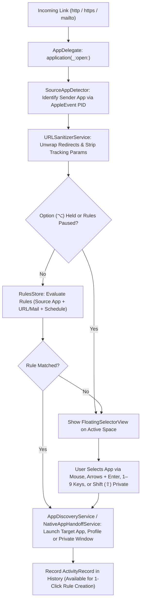

<p align="center">
  
</p>

<h1 align="center">Maxgus Picker 1824 (<code>maxguspicker1824</code>)</h1>

<p align="center">
  <strong>A native macOS Link &amp; Mail Router with Multi-Browser Profile Support, Source-App Detection, URL Sanitization, Native Desktop App Handoff, Work-Hours Scheduling, and a Visual Rule Engine.</strong>
</p>

<p align="center">
  
  
  
  
</p>

**Maxgus Picker 1824** (`maxguspicker1824`) is a fast, native, menu-bar macOS utility inspired by Bumpr, Choosy, and Velja. When registered as your default web browser and default email reader, it intercepts every `http`, `https`, and `mailto` link you click across macOS, sanitizes tracking parameters, unwraps nested redirects, and decides how to open the link in milliseconds:

- **Matches an Active Rule?** Automatically routes the link in the background to your configured browser, specific **Browser Profile / Space**, **Private / Incognito window**, or **Mail Client**.
- **No Rule Match (or `Option ⌥` Held)?** Spawns a desktop-scaled, draggable, keyboard-navigable **Floating App Selector** right on your active Space (including over Full-Screen apps) so you can choose the target app with your mouse, arrow keys, or `1`–`9` number hotkeys.

---

## 📸 Visual Tour & Screenshots

### 1. Floating App Selector (Standard & Power-User Modes)

| Standard Floating Chooser | Private Mode (`⇧`), Native App Handoff & Full URL Preview |
| :---: | :---: |
|  |  |
| *Numbered `1–9` shortcut badges, green running-app status dots, source-app attribution (`• Slack`), and keyboard selection highlight.* | *Holding `Shift (⇧)` activates **Private Mode**, pressing `Space` expands the full URL inspector, `⌘C` copies the clean URL, and **Figma** appears as a native desktop handoff target.* |

---

### 2. Graphical Routing Rules Manager & Live Rule Tester

<p align="center">
  
</p>

- **Priority-Ordered Rule Cards**: Drag and drop rules to reorder evaluation priority, toggle rules on/off individually, and view at-a-glance badges for **Work Hours Schedules** (`Mon–Fri 09:00–18:00`), **Private / Incognito Windows** (`Private`), **Source App filters**, and **Target Browser Profiles** (`Work`).
- **Real-Time Rule Tester Bar**: Paste any URL or email address at the bottom of the window to immediately highlight which rule matches (in green) and preview the exact destination app and profile—or see if it falls back to the Floating App Selector.

---

### 3. Visual 3-Step Rule Builder & Setup Wizard

| 3-Step Rule Builder Sheet | 4-Step Setup & Permissions Guide |
| :---: | :---: |
|  |  |
| *Build rules from **Starter Templates**, **Recent History**, or scratch with Source App detection, Domain/Path/Regex operators, **Work Hours Schedules**, and **Private Window** toggles.* | *Guided 4-step setup for Default Browser, Default Mail Reader, Safari/Arc Accessibility Automation, and **Auto Start on Login**.* |

---

### 4. Menu Bar Control Center & `.dmg` Drag-and-Drop Installer

| Menu Bar Control Center | Universal macOS `.dmg` Installer |
| :---: | :---: |
|  |  |
| *Quick access to Pause Routing Rules, URL Sanitizer toggle, Running Browser prioritization, Re-route Active Browser Tab (`⌘⇧O`), and Recent History.* | *Self-contained `.dmg` installer with custom **Neon Prism Router** app icon and `/Applications` shortcut.* |

---

## ✨ Complete Feature Guide & Detailed Functionality

### 🎯 1. Floating App Selector & Power-User Keyboard Workflow
When an incoming link does not match any enabled routing rule (or when you hold **`Option (⌥)`** while clicking a link to bypass rules), the Floating App Selector appears right at your mouse cursor:
- **Dynamic Desktop-Proportional Sizing**: Automatically calculates panel width, height, and icon dimensions based on the active display's resolution (`NSScreen.visibleFrame`) and clamps coordinates so the chooser never clips off-screen.
- **Full-Screen Space Awareness**: Configured with `.nonactivatingPanel`, `.popUpMenu` window level, and `[.canJoinAllSpaces, .fullScreenAuxiliary, .transient]` collection behaviors so the chooser always opens directly over Full-Screen macOS apps without switching back to the Desktop Space.
- **Free Window Dragging**: Click and drag anywhere on the chooser background or top grip bar to reposition the floating panel on screen.
- **Arrow Key & `Tab` Navigation (`←` / `→` / `↑` / `↓` / `Tab`)**: Cycle through available browsers and mail clients with smooth auto-scrolling and a high-contrast blue selection ring, then press **`Enter (⏎)`** to launch.
- **Instant Number Hotkeys (`1`–`9`)**: The first 9 applications display a numbered badge (`1` through `9`) on the top-left of their tile. Pressing the corresponding number key immediately launches that application.
- **Private / Incognito Launch Modifier (`⇧ Shift`)**: Hold **`Shift (⇧)`** while clicking an app, pressing `Enter`, or pressing `1`–`9` to open the link in a **Private / Incognito Window**. While `Shift` is held, an orange **`Private Mode`** indicator badge appears live in the chooser header:
  - **Chromium Browsers (Chrome, Brave, Edge, Vivaldi)**: Launches with `--incognito` (or `--inprivate` for Microsoft Edge).
  - **Firefox**: Launches with `-private-window <url>`.
  - **Safari**: Automates `File → New Private Window` via AppleScript and loads the target URL.
- **One-Key Clean URL Copy (`⌘C`)**: Press **`⌘C`** or click the clipboard button in the top bar to copy the sanitized URL (or extracted email address for `mailto:` links) to the macOS pasteboard with a green **`✓ Copied`** confirmation badge.
- **Expandable Full-URL Inspector (`Space`)**: Press **`Space`** or click the domain pill in the header to expand a multi-line monospaced banner displaying the full URL path and query string before deciding where to open it.
- **Running Application Indicator & Prioritization**: Currently running browsers display a **green status dot** in the bottom-right corner of their icon and are automatically sorted first when *Prioritize Running Browsers* is enabled.

---

### 🧹 2. URL Hygiene: Tracking Parameter Stripper & Redirect Unwrapper
Before evaluating routing rules or displaying a link in the chooser, [`URLSanitizerService`](Sources/maxguspicker1824/Services/URLSanitizerService.swift) cleans incoming web URLs in memory (recursively up to 4 layers deep):
- **Unwraps Redirect & SafeLink Wrappers**:
  - **Google Redirects**: Extracts the destination URL from `https://www.google.com/url?q=...` and `?url=...`.
  - **Microsoft Outlook SafeLinks**: Unwraps `*.safelinks.protection.outlook.com/?url=...` directly to the underlying URL.
  - **Slack, Facebook & YouTube Redirects**: Unwraps `slack-redir.net/link?url=...`, `l.facebook.com/l.php?u=...`, and `youtube.com/redirect?q=...`.
- **Strips Marketing & Tracking Query Parameters**:
  - Automatically removes `utm_source`, `utm_medium`, `utm_campaign`, `utm_term`, `utm_content`, `utm_id`, `fbclid`, `gclid`, `dclid`, `gbraid`, `wbraid`, `msclkid`, `twclid`, `igshid`, `mc_cid`, `mc_eid`, `_hsenc`, `_hsmi`, `hsCtaTracking`, `mkt_tok`, `vero_id`, `oly_enc_id`, `oly_anon_id`, `rb_clickid`, `s_kwcid`, `yclid`, and `ref_src` while preserving all legitimate functional query parameters.
- **Menu Bar Toggle**: Can be enabled or disabled at any time via **Menu Bar → Strip Tracking Parameters & Redirects**.

---

### 🚀 3. Web-to-Native Desktop App Handoff
[`NativeAppHandoffService`](Sources/maxguspicker1824/Services/NativeAppHandoffService.swift) detects when a clicked web URL belongs to an installed native macOS desktop app and surfaces that desktop app first in the chooser (with a blue `arrow.up.forward.app.fill` badge), converting the `https://` URL into the app's native deep-link scheme upon launch:

| Service | Matched Web Domains / Paths | Installed macOS Bundle ID | Native Deep-Link Conversion |
| :--- | :--- | :--- | :--- |
| **Zoom** | `zoom.us/j/<id>`, `*.zoom.us/my/...` | `us.zoom.xos` | Converts `/j/<meetingID>?pwd=...` directly into `zoommtg://zoom.us/join?action=join&confno=<id>&pwd=<pwd>` |
| **Figma** | `figma.com/file/...`, `figma.com/design/...`, `figma.com/proto/...`, `figma.com/board/...` | `com.figma.Desktop` | Rewrites `https://www.figma.com/...` to `figma://...` |
| **Notion** | `notion.so/...`, `*.notion.site/...` | `notion.id` | Rewrites `https://` to `notion://` |
| **Linear** | `linear.app/...` | `com.linear` | Rewrites `https://linear.app/...` to `linear://...` |
| **Spotify** | `open.spotify.com/track\|album\|playlist\|artist\|episode\|show/<id>` | `com.spotify.client` | Converts web path into `spotify:<type>:<id>` URI |
| **Discord** | `discord.com/channels/...`, `discordapp.com/channels/...` | `com.hnc.Discord` | Rewrites `https://` to `discord://` |
| **Microsoft Teams** | `teams.microsoft.com/l/meetup-join/...` | `com.microsoft.teams2`, `com.microsoft.teams` | Rewrites `https://` to `msteams://` |

---

### 🧠 4. Multi-Browser Profile & Space Discovery
[`ProfileDiscoveryService`](Sources/maxguspicker1824/Services/ProfileDiscoveryService.swift) inspects local browser configuration files to discover your configured profiles and spaces so you can target them either from the Floating App Selector dropdown or inside Routing Rules:
- **Chromium Family (Google Chrome, Brave Browser, Microsoft Edge, Vivaldi)**:
  - Parses `~/Library/Application Support/<Browser>/Local State` (`profile.info_cache`) to map internal profile directories (`Default`, `Profile 1`, `Profile 2`, ...) to your human-readable profile names (`Work`, `Personal`, `Client`, etc.).
  - Launches directly into the chosen profile via `open -na "<AppPath>" --args --profile-directory="<ProfileID>" "<URL>"`.
- **Mozilla Firefox**:
  - Parses `~/Library/Application Support/Firefox/profiles.ini` and launches the selected profile with `-P "<ProfileName>" "<URL>"`.
- **Arc Browser**:
  - Queries Arc's AppleScript dictionary (`tell application "Arc" to get title of every space`) and opens links directly inside the target Space.
- **Apple Safari**:
  - Supports custom Safari Profiles and GUI scripting via Accessibility permissions.

---

### ⚙️ 5. Visual Routing Rules Engine, Work-Hours Scheduling & Live Tester
[`RulesStore`](Sources/maxguspicker1824/Services/RulesStore.swift) evaluates incoming links top-to-bottom against your ordered list of rules:
- **Source Application Filtering ([`SourceAppDetector`](Sources/maxguspicker1824/Services/SourceAppDetector.swift))**:
  - Extracts `keyAddressAttr` (`typeKernelProcessID`) from the incoming AppleEvent descriptor (`NSAppleEventManager.shared().currentAppleEvent`) with fallback to `NSWorkspace.shared.frontmostApplication`, identifying which app you clicked the link in (e.g., *Slack*, *Mail*, *Messages*, *VS Code*, *Terminal*, *Notion*).
  - Rules can match **only a Source App** (e.g., *"Open all links clicked in Slack with Microsoft Edge"*), **only a URL/Email condition**, or **both combined**.
- **Web & Email Match Fields & Operators**:
  - **Web Links (`http` / `https`)**: Match against **Website Domain** (`host`, automatically normalizing `www.`), **URL Path**, or **Full Web Address**.
  - **Email Links (`mailto:`)**: Match against **Recipient Email** (`user@company.com`), **Email Domain** (`company.com`), or **Email Subject** (`?subject=...`).
  - **Operators**: `contains`, `equals`, `starts with`, `ends with`, and **Regular Expression (`regex`)** (evaluated with `NSRegularExpression` case-insensitive matching).
- **Work Hours / Schedule Conditions ([`RuleSchedule`](Sources/maxguspicker1824/Models/RoutingRule.swift))**:
  - Restrict any rule to specific **days of the week** (`Mon`–`Sun`) and a **time window** (`From HH:00 To HH:00`, including overnight ranges).
  - Example: Route `github.com` and `jira.atlassian.com` links to your *Work* browser profile Monday–Friday `09:00–18:00`, and automatically fall back to your personal browser on evenings and weekends.
- **Per-Rule Private / Incognito Mode**:
  - Enable **"Open in Private / Incognito Window"** on any rule so matching URLs always open in an isolated private session.
- **Starter Rule Templates ([`RuleTemplatePreset`](Sources/maxguspicker1824/Models/RoutingRule.swift))**:
  - One-click presets in both the Routing Rules toolbar and the Rule Builder sheet:
    1. **Google Workspace & Meet** (`docs.google.com`, `drive.google.com`, `meet.google.com`, `calendar.google.com`)
    2. **GitHub & GitLab Repositories** (`github.com`, `gitlab.com`)
    3. **Localhost & Dev Ports** (`localhost`, `127.0.0.1`, `0.0.0.0`, `*.local`)
    4. **Jira, Linear & Notion** (`atlassian.net`, `linear.app`, `notion.so`)
    5. **Figma & Miro Design Boards** (`figma.com`, `miro.com`)
    6. **Zoom & Teams Meetings** (`zoom.us`, `teams.microsoft.com`)
- **Create Rules from Recent Activity History**:
  - Every link you open is recorded in `RulesStore.recentActivity` (up to 25 recent links with domain/recipient, source app, and target app/profile).
  - Select any previously opened link from **Routing Rules → From History** (or **Rule Builder → Fill from History**, or **Menu Bar → Recent Routed Links**) to pre-populate a new routing rule in one click.
- **JSON Rule Export & Import**:
  - Back up your routing rules to a formatted `.json` file or share rule sets across Macs via the **`⋯` (Export / Import)** menu in the Routing Rules toolbar.

---

### 🔄 6. Re-route Active Browser Tab (`⌘⇧O`)
Already opened a link in the wrong browser? Click **Menu Bar → Re-route Active Browser Tab... (`⌘⇧O`)**:
- Queries the frontmost/running browser (*Safari*, *Google Chrome*, *Brave Browser*, *Microsoft Edge*, *Arc*, or *Vivaldi*) via AppleScript for the URL of its active tab and immediately opens the **Floating App Selector** so you can hand that tab off to another browser, profile, or native desktop app.

---

## 🧭 Architecture & Routing Flow



---

## 📂 Project Structure

```text
maxguspicker1824/
├── Package.swift                                      # SwiftPM manifest (macOS 14+)
├── Makefile                                           # build, app, dmg, install, run, test, and clean targets
├── LICENSE                                            # MIT License
├── TODO.md                                            # Phased engineering implementation tracker
├── .github/workflows/
│   └── release.yml                                    # Automated Universal macOS .dmg GitHub Release on v* tag push
├── docs/screenshots/                                  # Retina UI screenshots for documentation
│   ├── app-icon.png
│   ├── dmg-installer.png
│   ├── floating-selector.png
│   ├── floating-selector-private-handoff.png
│   ├── menubar-menu.png
│   ├── onboarding-wizard.png
│   ├── rule-builder.png
│   └── rules-manager.png
├── Resources/
│   ├── AppIcon.icns                                   # Multi-resolution macOS Neon Prism Router icon bundle
│   ├── Info.plist                                     # LSUIElement + AppIcon + http/https/mailto URL schemes
│   └── maxguspicker1824.entitlements                  # Sandbox disabled + AppleEvents entitlement
├── scripts/
│   ├── bundle_app.sh                                  # Compiles, embeds AppIcon.icns & signs .app bundle (supports UNIVERSAL=1)
│   ├── generate_icon.swift                            # CoreGraphics generator for the 1024x1024 Neon Prism Router icon
│   └── package_dmg.sh                                 # Packages .app + /Applications symlink into a compressed .dmg with SHA-256
├── Sources/maxguspicker1824/
│   ├── App/
│   │   ├── maxguspicker1824App.swift                  # @main entry point & MenuBarExtra control center
│   │   └── AppDelegate.swift                          # URL interception, FloatingPanel, keyboard monitors & window management
│   ├── Models/
│   │   ├── AppTarget.swift                            # BrowserEngine, BrowserProfile, AppTarget, SourceAppInfo
│   │   └── RoutingRule.swift                          # RouteType, MatchField, RuleSchedule, RoutingRule, ActivityRecord, presets
│   ├── Services/
│   │   ├── AppDiscoveryService.swift                  # Handler discovery, profile/private launch & active tab handoff
│   │   ├── NativeAppHandoffService.swift              # Zoom, Figma, Notion, Linear, Spotify, Discord, Teams deep links
│   │   ├── ProfileDiscoveryService.swift              # Chrome, Brave, Edge, Vivaldi, Firefox, Arc & Safari profiles
│   │   ├── RulesStore.swift                           # Rule evaluation engine, schedules, history & JSON export/import
│   │   ├── SourceAppDetector.swift                    # AppleEvent PID & frontmost app detection
│   │   ├── SystemIntegrationService.swift             # Default browser/mail, Accessibility & Auto Start on Login
│   │   └── URLSanitizerService.swift                  # Tracking parameter stripper & redirect/SafeLink unwrapper
│   └── Views/
│       ├── FloatingSelectorView.swift                 # Desktop-scaled, keyboard-navigable floating picker UI
│       ├── OnboardingWizardView.swift                 # 4-step setup & permissions wizard
│       ├── RuleBuilderSheet.swift                     # Visual rule builder with schedules, templates & history fill
│       └── RulesManagerView.swift                     # Graphical rules list, cards, templates, export/import & live tester
└── Tests/maxguspicker1824Tests/
    └── RulesStoreTests.swift                          # Unit test suite for routing rules, sanitizer, deep links & schedules
```

---

## 🛠️ How to Install, Build, Package `.dmg`, and Test

### Option A: Download Pre-Built Universal `.dmg` Installer
Download the latest `maxguspicker1824.dmg` from the [**GitHub Releases**](https://github.com/alejandro-llanes/maxguspicker1824/releases) page, open the disk image, and drag **`maxguspicker1824`** into your **`Applications`** folder.

### Option B: Build & Install from Source

#### Prerequisites
- **macOS 14.0 (Sonoma)** or later
- **Apple Command Line Tools** or **Xcode** (`swift` 5.9+ / 6.x)

#### 1. Build, Install to `/Applications`, and Launch
```bash
make install
```

#### 2. Build Only (into `build/maxguspicker1824.app`)
```bash
make app
```

#### 3. Package a macOS `.dmg` Installer Locally
```bash
make dmg
```
Outputs `build/maxguspicker1824-<version>.dmg`, `build/maxguspicker1824.dmg`, and `.sha256` checksum files.

#### 4. Automated GitHub Release (`.dmg`) via Git Tag
Pushing any version tag matching `v*` triggers [`.github/workflows/release.yml`](.github/workflows/release.yml), which runs the unit test suite, compiles a **Universal (`arm64` + `x86_64`)** `.app` bundle, packages the `.dmg` installer and `.sha256` checksums, and publishes a GitHub Release automatically:
```bash
git tag v1.1.0
git push origin v1.1.0
```

#### 5. Test Link & Mail Routing from the Terminal
```bash
# Test a standard web link
open "https://github.com/alejandro-llanes"

# Test URL unwrapping & tracking parameter stripping
open "https://www.google.com/url?q=https%3A%2F%2Fgithub.com%2Falejandro-llanes%3Futm_source%3Dnewsletter%26fbclid%3D12345"

# Test an email link with subject
open "mailto:billing@acme.com?subject=Monthly%20Invoice"
```

#### 6. Run the Automated Unit Tests
```bash
make test
```

---

## ⌨️ Complete Keyboard Shortcuts Reference

| Shortcut / Action | Context | Behavior |
| :--- | :---: | :--- |
| **`Option (⌥)` + Click Link** | Any App | Bypass all routing rules and force the Floating App Selector at the cursor |
| **`←` / `→` / `↑` / `↓` / `Tab`** | Floating Chooser | Move the selection highlight across available applications |
| **`Enter (⏎)`** | Floating Chooser | Launch the currently highlighted application |
| **`1` – `9` Number Keys** | Floating Chooser | Instantly launch the corresponding numbered application tile |
| **`Shift (⇧)` + `Enter` / Click / `1–9`** | Floating Chooser | Open the link in a **Private / Incognito** browser window (shows live `Private Mode` badge) |
| **`⌘ C`** | Floating Chooser | Copy the sanitized URL (or email address) to the clipboard |
| **`Space`** | Floating Chooser | Toggle the expanded full-URL monospaced preview banner |
| **`Esc`, `×`, or Click Outside** | Floating Chooser | Dismiss the Floating App Selector without opening any application |
| **`⌘ ⇧ O`** | Menu Bar | Grab the active tab URL from your current browser and re-route it in the Floating Chooser |
| **`⌘ ,`** | Menu Bar | Open the **Routing Rules** graphical editor window |
| **`⌘ Q`** | Menu Bar | Quit Maxgus Picker 1824 |

---

## 📄 License

This project is licensed under the **MIT License** — see the [LICENSE](LICENSE) file for details.
