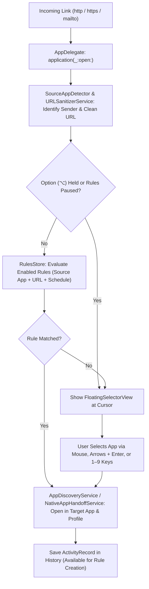

<p align="center">
  
</p>

# maxguspicker1824

> **A native macOS Link & Mail Router with Multi-Browser Profile Support, Source-App Detection, URL Sanitization, Native Desktop App Handoff, and a Visual Rule Engine.**

-blue)


**maxguspicker1824** is a lightweight, menu-bar macOS utility inspired by Bumpr, Choosy, and Velja. When set as your default web browser and default email reader, it intercepts every `http`, `https`, and `mailto` link you click across macOS:

- **Matches a Rule?** Automatically forwards the link to your configured browser (and specific browser profile/space, or Private/Incognito window) or mail client in the background.
- **No Rule Match?** Spawns a sleek, desktop-scaled, draggable floating chooser right on your active Space (including over Full-Screen apps) so you can pick the app or profile with your mouse, arrow keys, or `1`–`9` number hotkeys.

---

## 📸 Screenshots

| Floating App Selector | Menu Bar Control Center |
| :---: | :---: |
|  |  |
| *Desktop-scaled, draggable cursor-positioned floating selector* | *Menu bar status icon with pause toggle, rule counter & recent activity* |

### Visual 3-Step Rule Builder & Routing Rules Editor

<p align="center">
  
</p>

---

## ✨ Features

### 1. ⚡ Cursor-Positioned Floating App & Profile Selector
- **Appears Right at Your Cursor & Over Full-Screen Apps**: Spawns a borderless, non-activating `NSPanel` with `.ultraThinMaterial` blur scaled to your display resolution on the active Space (including over full-screen applications).
- **Full Keyboard & Mouse Navigation**:
  - **Arrow Keys (`←` / `→` / `↑` / `↓` / `Tab`) + `Enter` (`⏎`)**: Navigate between available apps with a highlighted selection frame and press `Enter` to launch.
  - **Number Key Instant Launch (`1`–`9`)**: Press keys `1` through `9` to immediately launch the corresponding numbered app tile.
  - **Private / Incognito Launch (`Shift ⇧` + `Enter` / Click / `1`–`9`)**: Hold `Shift` when selecting a browser to open the link in an Incognito / InPrivate / Private window.
  - **Quick Copy Clean URL (`⌘C`)**: Press `⌘C` or click the copy icon next to the domain pill to copy the sanitized URL to your clipboard.
  - **Expandable Full URL Preview (`Space`)**: Press `Space` or click the domain pill to expand the full URL path and query string before opening.
- **Running App Indicator & Priority Sorting**: Shows a green status dot on browsers currently running in macOS and optionally sorts running browsers first.
- **Freely Draggable**: Grab the top handle or anywhere on the panel background to reposition the floating selector on screen.
- **Modifier Key Override (`Option ⌥`)**: Hold **Option (`⌥`)** while clicking any link to bypass all automatic routing rules and force the floating selector to appear.

### 2. 🧹 URL Hygiene & Smart Unwrapping (`URLSanitizerService`)
- **Tracking Parameter Stripper**: Automatically removes marketing and tracking query parameters (`utm_source`, `utm_medium`, `utm_campaign`, `fbclid`, `gclid`, `msclkid`, `mc_eid`, `igshid`, `_hsenc`, etc.) while keeping legitimate query parameters intact.
- **Redirect & SafeLink Unwrapper**: Automatically unwraps nested redirect links from **Google** (`google.com/url?q=...`), **Microsoft Outlook SafeLinks** (`*.safelinks.protection.outlook.com`), **Slack**, **Facebook**, and **YouTube** so your domain rules match the true destination URL.

### 3. 💻 Web-to-Native Desktop App Handoff (`NativeAppHandoffService`)
- Automatically detects when a web link corresponds to an installed native macOS desktop app and offers/converts it to a native deep link without leaving behind an empty browser tab:
  - **Zoom** (`zoom.us/j/...` → `zoommtg://`)
  - **Figma** (`figma.com/design/...` → `figma://`)
  - **Notion** (`notion.so/...` → `notion://`)
  - **Linear** (`linear.app/...` → `linear://`)
  - **Spotify** (`open.spotify.com/...` → `spotify://`)
  - **Discord** (`discord.com/channels/...` → `discord://`)
  - **Microsoft Teams** (`teams.microsoft.com/l/...` → `msteams://`)

### 4. 🌐 Deep Browser Profile & Workspace Discovery
Automatically detects and launches links into specific profiles or spaces without spawning duplicate Dock instances:

| Browser | Profile Discovery Source | Launch Mechanism |
| :--- | :--- | :--- |
| **Google Chrome** | `~/Library/Application Support/Google/Chrome/Local State` | Direct binary invocation with `--profile-directory="<Dir>"` (`--incognito` supported) |
| **Brave Browser** | `~/Library/Application Support/BraveSoftware/Brave-Browser/Local State` | Direct binary invocation with `--profile-directory="<Dir>"` (`--incognito` supported) |
| **Microsoft Edge / Vivaldi** | Chromium `Local State` (`profile.info_cache`) | Direct binary invocation with `--profile-directory="<Dir>"` (`--inprivate` / `--incognito`) |
| **Firefox** | `~/Library/Application Support/Firefox/profiles.ini` | Direct binary invocation with `-P "<ProfileName>"` (`-private-window` supported) |
| **Arc** | Live AppleScript query of front window Spaces | AppleScript targeting `space "<SpaceName>"` |
| **Safari (macOS 14+)** | `System Events` inspection of `File → New Window` profile items | Reuses open `<Profile> —` window or triggers `New <Profile> Window` |
| **Mail Clients** | LaunchServices `mailto:` handler discovery | Standard `NSWorkspace` activation & URL handoff |

### 5. 🎯 Context-Aware Source App, Work Hours Scheduling & History Rules
- **Source Application Routing**: Detects which application originated the click (e.g., Slack, Notion, Linear, Terminal, Apple Mail) via `kAEGetURL` AppleEvent sender PID (`keyAddressAttr`) with fallback to `NSWorkspace.shared.frontmostApplication`.
- **Work Hours / Schedule Conditions (`RuleSchedule`)**: Restrict any rule to specific days of the week and hours of the day (e.g., *Mon–Fri, 09:00–18:00*).
- **Create Rules from History**: Create routing rules directly from your history of previously opened links via **Menu Bar → Recent Activity**, the **From History** button in the Rules Manager, or inside the **Rule Builder Sheet**.
- **Starter Templates & JSON Import/Export**: Includes built-in one-click rule templates (*Localhost & Dev Servers*, *GitHub & GitLab*, *Google Workspace (Work Hours)*, *Video Calls*, *Figma/Notion/Linear*) plus full JSON Export and Import.
- **Re-route Active Browser Tab (`⌘⇧O`)**: Grab the URL of the active tab from your frontmost browser (Safari, Chrome, Brave, Edge, Arc) and open it in the floating chooser to hand it off to another browser or profile.

---

## 🧭 Architecture & Routing Flow



---

## 📂 Project Structure

```text
maxguspicker1824/
├── Package.swift                                      # SwiftPM manifest (macOS 14+)
├── Makefile                                           # Build, bundle, install, run, test, and clean targets
├── LICENSE                                            # MIT License
├── TODO.md                                            # Phased implementation tracker
├── docs/screenshots/                                  # Cropped UI screenshots for documentation
│   ├── floating-selector.png
│   ├── menubar-menu.png
│   └── rule-builder.png
├── .github/workflows/
│   └── release.yml                                    # Automated Universal macOS .dmg GitHub Release on v* tag push
├── Resources/
│   ├── Info.plist                                     # LSUIElement + http/https/mailto URL schemes
│   └── maxguspicker1824.entitlements                  # Sandbox disabled + AppleEvents entitlement
├── scripts/
│   ├── bundle_app.sh                                  # Compiles, assembles & signs .app bundle (supports UNIVERSAL=1)
│   └── package_dmg.sh                                 # Packages .app into a macOS .dmg installer with SHA-256 checksums
├── Sources/maxguspicker1824/
│   ├── App/
│   │   ├── maxguspicker1824App.swift                  # @main entry point & MenuBarExtra scene
│   │   └── AppDelegate.swift                          # URL interception, FloatingPanel & window management
│   ├── Models/
│   │   ├── AppTarget.swift                            # BrowserEngine, BrowserProfile, AppTarget, SourceAppInfo
│   │   └── RoutingRule.swift                          # RouteType, MatchField, RuleSchedule, RoutingRule, ActivityRecord
│   ├── Services/
│   │   ├── AppDiscoveryService.swift                  # Handler discovery, profile/private launch & tab handoff
│   │   ├── NativeAppHandoffService.swift              # Zoom, Figma, Notion, Linear, Spotify, Discord, Teams deep links
│   │   ├── ProfileDiscoveryService.swift              # Chrome, Brave, Edge, Vivaldi, Firefox, Arc & Safari profiles
│   │   ├── RulesStore.swift                           # Rule evaluation engine, persistence, history & JSON export/import
│   │   ├── SourceAppDetector.swift                    # AppleEvent PID & frontmost app detection
│   │   ├── SystemIntegrationService.swift             # Default browser/mail, Accessibility & Auto Start on Login
│   │   └── URLSanitizerService.swift                  # Tracking parameter stripper & redirect/SafeLink unwrapper
│   └── Views/
│       ├── FloatingSelectorView.swift                 # Desktop-scaled, keyboard-navigable floating picker UI
│       ├── OnboardingWizardView.swift                 # 4-step setup & permissions wizard
│       ├── RuleBuilderSheet.swift                     # Visual rule builder with schedules, templates & history fill
│       └── RulesManagerView.swift                     # Graphical rules list, cards, templates, export/import & live tester
└── Tests/maxguspicker1824Tests/
    └── RulesStoreTests.swift                          # Unit test suite for routing rules, sanitizer, deep links & schedules
```

---

## 🛠️ How to Build, Package `.dmg`, Install, and Release

### Prerequisites
- **macOS 14.0 (Sonoma)** or later
- **Apple Command Line Tools** or **Xcode** (`swift` 5.9+ / 6.x)

### 1. Build, Install to `/Applications`, and Launch
```bash
make install
```

### 2. Build Only (into `build/maxguspicker1824.app`)
```bash
make app
```

### 3. Build a macOS `.dmg` Installer Locally
```bash
make dmg
```
Creates `build/maxguspicker1824-<version>.dmg` (and `build/maxguspicker1824.dmg`) complete with an `/Applications` drag-and-drop shortcut and `.sha256` checksum files.

### 4. Automated GitHub Release (`.dmg`) via Git Tag
Pushing any version tag matching `v*` triggers [`.github/workflows/release.yml`](.github/workflows/release.yml), which runs the unit test suite, compiles a **Universal (`arm64` + `x86_64`)** `.app` bundle, packages the `.dmg` installer and `.sha256` checksums, and publishes a GitHub Release automatically:
```bash
git tag v1.1.0
git push origin v1.1.0
```

### 5. Test Link & Mail Routing from the Terminal
```bash
# Test a web link
open "https://github.com/alejandro-llanes"

# Test URL unwrapping & tracking parameter stripping
open "https://www.google.com/url?q=https%3A%2F%2Fgithub.com%2Falejandro-llanes%3Futm_source%3Dtest"

# Test an email link with subject
open "mailto:billing@acme.com?subject=Monthly%20Invoice"
```

### 6. Run the Automated Unit Tests
```bash
make test
```

---

## ⌨️ Shortcuts & Tips

| Shortcut / Action | Behavior |
| :--- | :--- |
| **`Option (⌥)` + Click Link** | Bypass all routing rules and force the floating app selector at the cursor |
| **`←` / `→` (or `Tab`) + `Enter (⏎)`** | Highlight an application in the chooser and press `Enter` to open |
| **`1` – `9` Number Keys** | Instantly launch the corresponding numbered application in the chooser |
| **`Shift (⇧)` + `Enter` / Click / `1–9`** | Open the link in a **Private / Incognito** browser window |
| **`⌘ C` (in Chooser)** | Copy the sanitized URL or email address to the clipboard |
| **`Space` (in Chooser)** | Toggle the expanded full-URL path & query preview |
| **`⌘ ⇧ O` (in Menu Bar)** | Re-route the active tab from your current browser via the floating chooser |
| **`⌘ ,` (in Menu Bar)** | Open the **Routing Rules** graphical editor |
| **`Esc`, `×`, or Click Outside** | Dismiss the floating app selector without opening any application |

---

## 📄 License

This project is licensed under the **MIT License** — see the [LICENSE](LICENSE) file for details.
